# FDT 飞书接入指南（图文版）

本文说明如何把 **FDT 审批网关** 接到企业飞书：自建应用、网页应用（H5）、审批定义、事件回调，以及租户后台 / 内网 Portal 侧的配置与排错。配套截图来自实际联调过程；操作原则与 [部署说明.md](部署说明.md) §4、§5 一致。

> **核心原则**：文件永不离开内网。飞书只看到**清单元数据**；跨区凭证是签名二维码 QR#1 / QR#2。审批引擎始终是**飞书原生审批**，网关只负责验签、建实例、签放行码。

---

## 目录

1. [相关链接](#1-相关链接)
2. [整体流程](#2-整体流程)
3. [在飞书开放平台创建自建应用](#3-在飞书开放平台创建自建应用)
4. [添加「网页应用」能力](#4-添加网页应用能力)
5. [配置网页应用主页与打开方式](#5-配置网页应用主页与打开方式)
6. [安全设置：H5 可信域名](#6-安全设置h5-可信域名)
7. [权限与事件回调](#7-权限与事件回调)
8. [创建审批定义（表单字段对齐）](#8-创建审批定义表单字段对齐)
9. [应用审核与发布](#9-应用审核与发布)
10. [租户后台：上传 PK_内网 + 绑定飞书](#10-租户后台上传-pk_内网--绑定飞书)
11. [内网 Portal：绑定飞书用户 ID](#11-内网-portal绑定飞书用户-id)
12. [联调验收](#12-联调验收)
13. [常见问题](#13-常见问题)

---

## 1. 相关链接

### 官方文档

| 用途 | 链接 |
|---|---|
| 飞书开放平台首页 | https://open.feishu.cn/ |
| 开发者后台（创建/管理应用） | https://open.feishu.cn/app |
| 企业自建应用说明 | https://open.feishu.cn/document/home/develop-a-gadget-in-5-minutes/create-an-app |
| 网页应用能力 | https://open.feishu.cn/document/client-docs/h5/introduction |
| H5 可信域名 / JSAPI | https://open.feishu.cn/document/client-docs/h5/introduction |
| `scanCode` 扫码 JSAPI | https://open.feishu.cn/document/client-docs/h5/idevelopment/api/device/scan-code/scancode |
| 审批 OpenAPI（创建实例） | https://open.feishu.cn/document/server-docs/approval-v4/instance/create |
| 事件订阅与加密策略 | https://open.feishu.cn/document/server-docs/event-subscription-guide/event-subscription-configure-/encrypt-key-encryption-configuration-case |
| 管理后台 · 应用审核 | https://www.feishu.cn/admin |

### 本仓库 / 本部署

| 用途 | 路径或 URL |
|---|---|
| 部署总 runbook | [部署说明.md](部署说明.md) |
| 技术方案（审批边界） | [技术方案.md](技术方案.md) |
| 飞书表单控件映射示例 | [`config/feishu-form.example.json`](../config/feishu-form.example.json) |
| H5 源码（网关内嵌） | `webapp/` → 网关 `/app/` |
| 示例网关 H5 主页 | `https://fdt.do2.cn/app/`（按你的域名替换） |
| 事件回调地址 | `https://<网关域名>/callback` 或 `https://<网关域名>/callback/<tenantId>` |
| 内网 Portal 飞书 ID | 用户 Portal →「飞书 ID」页 |

---

## 2. 整体流程

```
内网 Portal 签发 QR#1（含飞书用户 ID / 清单 / Merkle）
        │ 人肉扫码
        ▼
飞书客户端打开网页应用 /app/
  scanCode → POST /submit → 网关验签 → 创建飞书审批实例
        │
        ▼
审批人在飞书原生审批里批示
        │
        ▼
H5 轮询 GET /qr2  （或事件回调 /callback）
        │
        ▼
网关双控签 QR#2 → 手机展示 → ATM 扫码兑付 / 完成导入
```

需要准备的凭据（稍后填入租户后台「绑定飞书」）：

| 字段 | 来源 |
|---|---|
| App ID / App Secret | 开放平台 → 凭证与基础信息 |
| 审批定义 Code | 审批管理后台发布后的 `approval_code` |
| Encrypt Key | 事件订阅 / 加密策略 |
| Verification Token | 事件订阅 / 加密策略 |

---

## 3. 在飞书开放平台创建自建应用

1. 打开 [开发者后台](https://open.feishu.cn/app)，使用企业管理员或开发者账号登录。
2. 创建**企业自建应用**（示例名：`Fasteda-data-transfer`，描述：数据传输审批引擎）。
3. 进入 **基础信息 → 凭证与基础信息**，记下 **App ID**、**App Secret**（Secret 只显示一次/需重置时再复制，勿写入公开文档）。

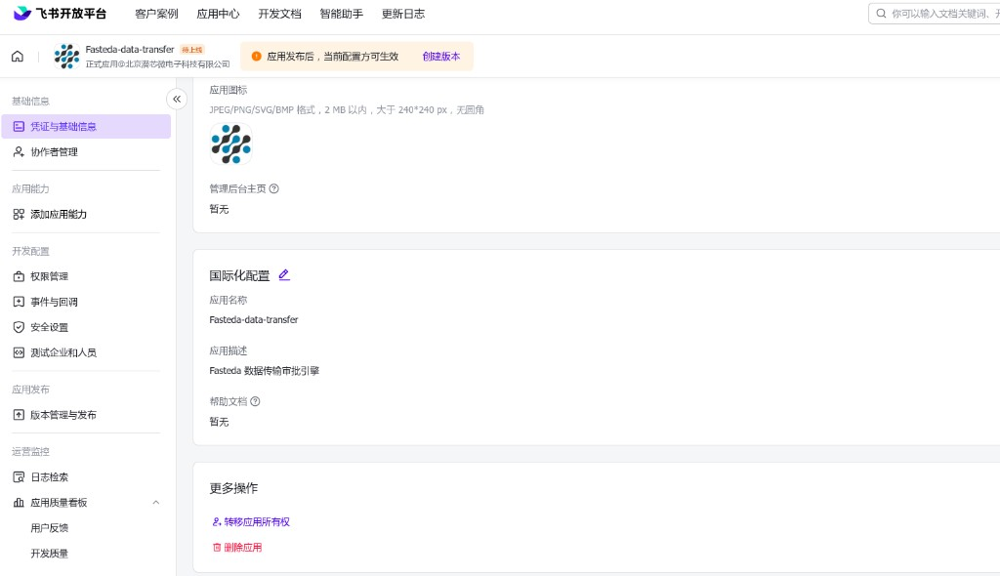

**权限（开发配置 → 权限管理）建议至少开通：**

| 用途 | 权限 |
|---|---|
| 应用身份拿 token | 应用身份相关基础权限 |
| 创建 / 查询审批实例 | `approval:approval`（及实例只读） |
| 可选：通讯录解析 | `contact:user.base:readonly` 等（若需工号→open_id） |

申请权限后需**创建版本并发布**，管理员在管理后台审核通过后才会对企业生效。

---

## 4. 添加「网页应用」能力

> 2025 年起飞书对新租户关闭**小程序**新建入口。FDT 使用 **网页应用（H5）**，由网关托管在 `/app/`。

1. 左侧 **应用能力 → 添加应用能力**。
2. 在「按能力添加」中找到 **网页应用**，点击 **+ 添加**。

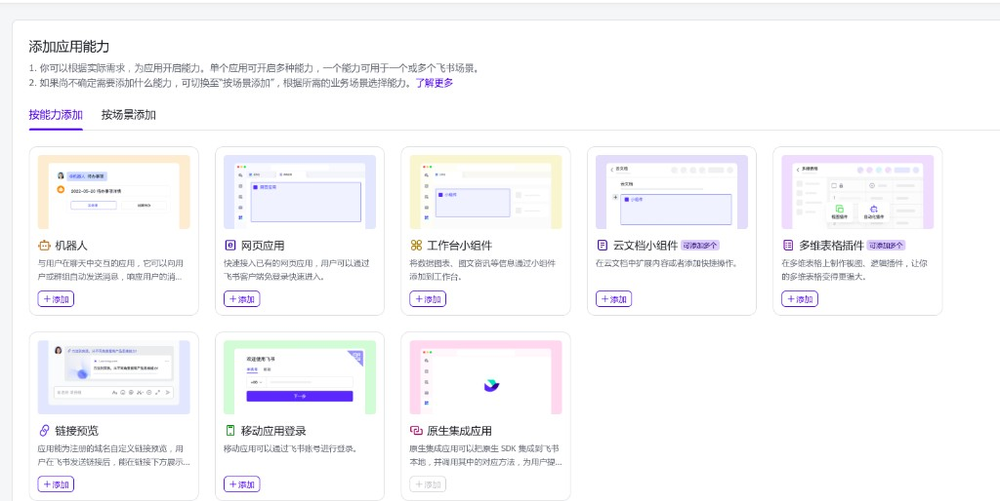

机器人 / 工作台小组件等**不是** FDT 必需能力；扫码入口只需网页应用。

---

## 5. 配置网页应用主页与打开方式

进入已添加的 **网页应用** 配置页：

| 项 | 填写 |
|---|---|
| 桌面端主页 | `https://<你的网关域名>/app/` |
| 移动端主页 | 同上（强烈建议两端都填） |
| 打开方式 | 推荐「在飞书内新标签页打开」 |

示例（联调域名 `fdt.do2.cn`）：

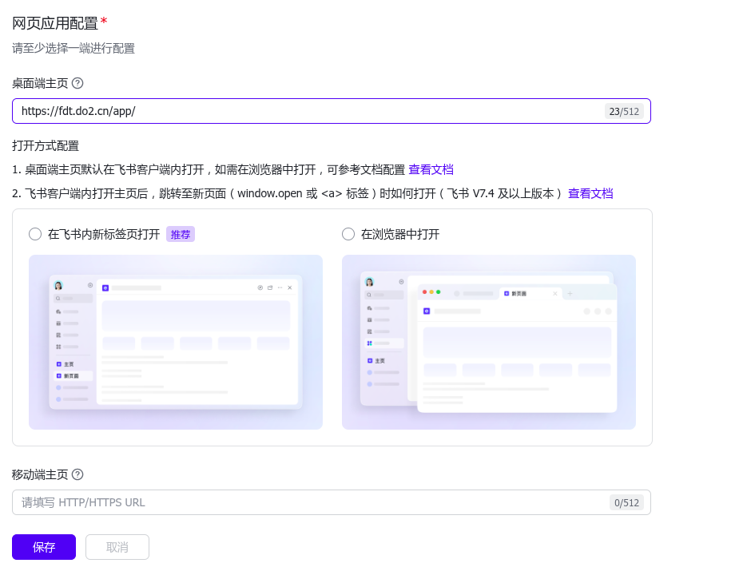

保存后，飞书工作台打开本应用即加载网关内嵌的 `webapp/` 页面（`scanCode` → `/submit` → 轮询 `/qr2`）。

证书必须是公网受信任链（可用网关内置 Let's Encrypt，见 [部署说明.md](部署说明.md) §4.4）。自签证书在飞书客户端内常会失败。

---

## 6. 安全设置：H5 可信域名

调用 `tt.scanCode` 等 JSAPI **必须**配置 H5 可信域名。

1. 左侧进入 **开发配置 → 安全设置**（见下图高亮项）。

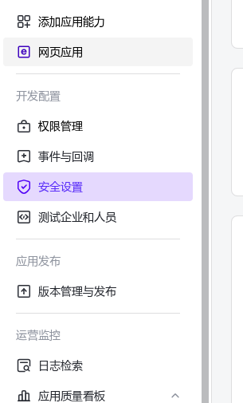

2. 在 **H5 可信域名** 中添加网关主机名。

| 正确示例 | 错误示例 |
|---|---|
| `https://fdt.do2.cn` | `fdt.do2.cn`（缺协议，会报「请填写有效的 HTTP/HTTPS URL」） |
| `https://fdt-gw.corp.example.com` | 带路径的 `/app/`（一般只填域名） |

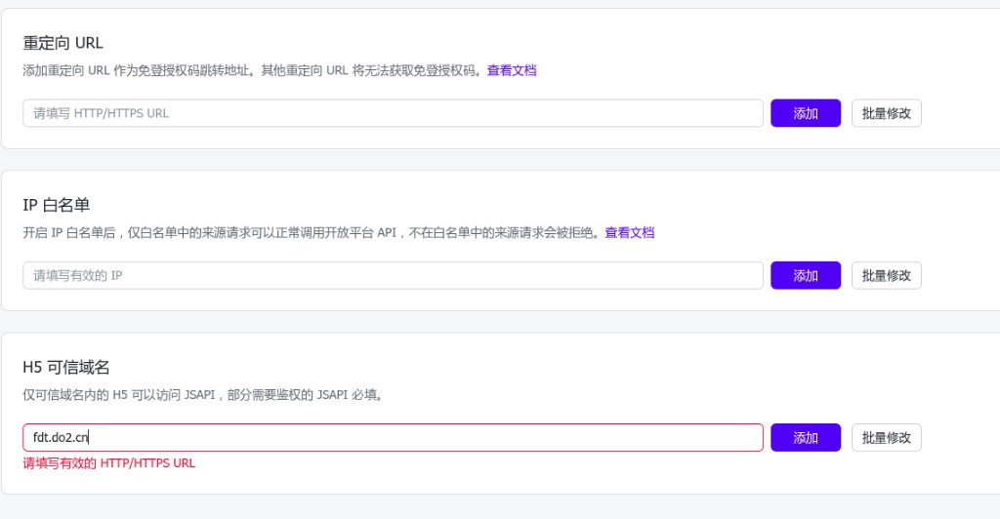

可选：

- **重定向 URL**：若另做 OAuth 免登再填。
- **IP 白名单**：启用后仅白名单源可调 OpenAPI；网关出口 IP 变化时需同步更新。

---

## 7. 权限与事件回调

### 7.1 两条取审批结果的路径

| 路径 | 说明 | 依赖 |
|---|---|---|
| **主路径：H5 轮询** | `GET /qr2?reqId=` → 网关调飞书查实例状态 | 审批读权限 |
| **推荐增强：事件回调** | 飞书推送到 `/callback`，验签后可更快出 QR#2 | Encrypt Key + Verification Token + 网关先启动 |

可只开轮询；生产建议两者都开。

### 7.2 配置事件订阅

1. **开发配置 → 事件与回调 → 事件配置**。
2. 先配置**订阅方式 / 请求地址**，再「添加事件」。


3. 请求地址示例：

```
https://fdt.do2.cn/callback/acme
```

单租户可用 `https://<域名>/callback`；多租户按 `callback/<tenantId>`。

4. 在 **加密策略** 页生成并保存 **Encrypt Key**、**Verification Token**，与租户后台「绑定飞书」中两项一致。

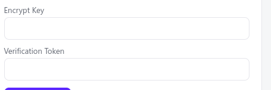

### 7.3 握手顺序（必读）

飞书保存事件订阅时会发 `url_verification`，网关须用 Encrypt Key 解密并**回显 challenge 的合法 JSON**。

**务必：网关已启动且 live 凭据正确 → 再在飞书点保存。**

若顺序反了或密钥不一致，会出现：

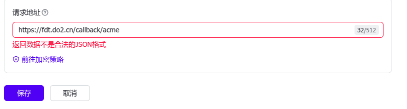

处理：确认 `/callback` 可达、HTTPS 正常、Encrypt Key 一致，点「前往加密策略」核对后重试保存。

---

## 8. 创建审批定义（表单字段对齐）

网关创建审批实例时，会按控件 **id / field** 填表。控件与 [`config/feishu-form.example.json`](../config/feishu-form.example.json)（或 Portal 管理后台「导出飞书表单 JSON」）必须一致，否则建实例失败。

### 8.1 基础信息

在飞书审批管理中新建审批（示例名：**数据导出**）：

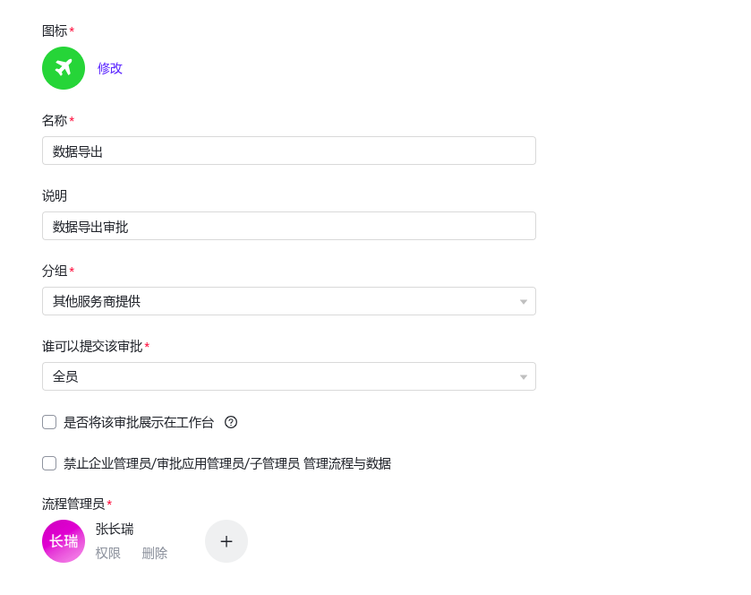

建议：

- 谁可以提交：按实际收窄；API 建实例时提交人由 `user_id` / `open_id` 指定。
- 「是否展示在工作台」可不勾（员工主要通过网页应用扫 QR#1 发起）。

### 8.2 表单设计

按下列逻辑字段拖控件（标题可中文，**控件 id 必须与网关 field 对齐**；把导出 JSON 里的 `id` 改成飞书后台真实 id）：

| 逻辑 field | 建议控件 | 说明 |
|---|---|---|
| `req_id` | 单行文本 | 申请单号 |
| `applicant` | 单行文本 | 申请人 |
| `dept` | 单行文本 | 部门 |
| `reason` | 多行文本 | 事由 |
| `class` | 单行 / 单选 | 密级（Portal 里 `cls` 映射为 `class`） |
| `merkle_root` | 单行文本 | 数据指纹 |
| `file_count` | 数字 / 单行 | 文件数 |
| `total_size` | 数字 / 单行 | 总字节 |
| `manifest` | 多行文本 | 文件清单或摘要 |

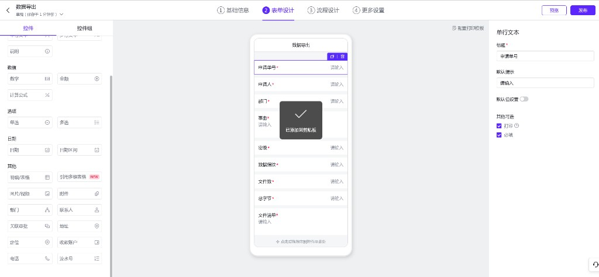

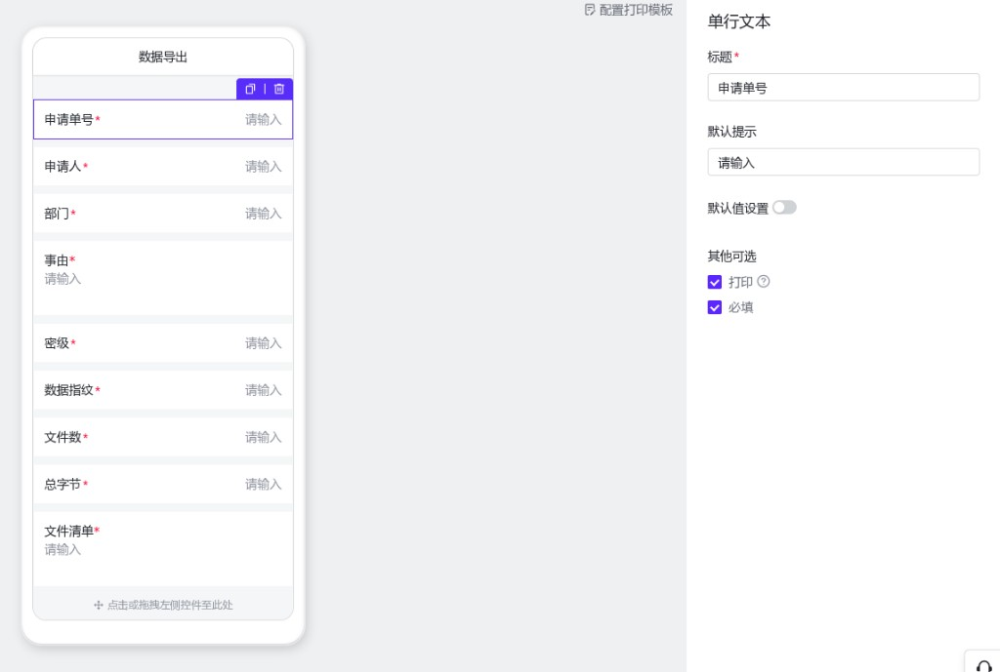

### 8.3 流程设计与发布

配置审批人（固定审批人 / 上级 / 按条件路由等）后 **发布**。发布后复制 **审批定义 Code**（`approval_code`，常见为 UUID 形态）：


---

## 9. 应用审核与发布

1. 开放平台 → **版本管理与发布** → 创建版本（写清变更：网页应用主页、权限、事件等）。
2. 企业管理员打开 [管理后台](https://www.feishu.cn/admin) → **工作台 → 应用审核**，通过审核。

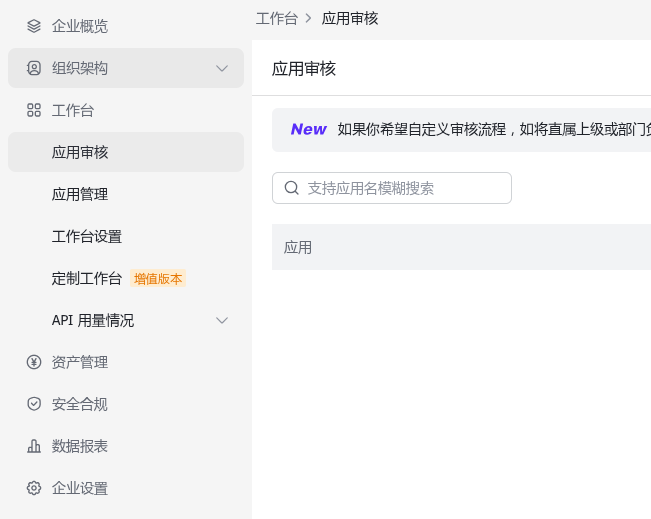

3. 设置应用**可用范围**（部门 / 成员），确保申请人与审批人在范围内。

---

## 10. 租户后台：上传 PK_内网 + 绑定飞书

网关侧租户控制台（`/console`）用于：上传内网验签公钥、绑定飞书 live 凭据、下载 `PK_网关`。

### 10.1 上传 PK_内网

内网 `install` 生成的 `pk_internal.pem` 上传到网关，用于验 QR#1：

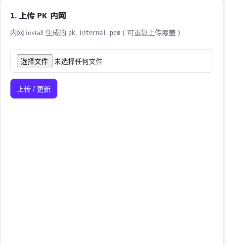

### 10.2 绑定飞书（live）

取消「联调 mock」，填写五项后保存：

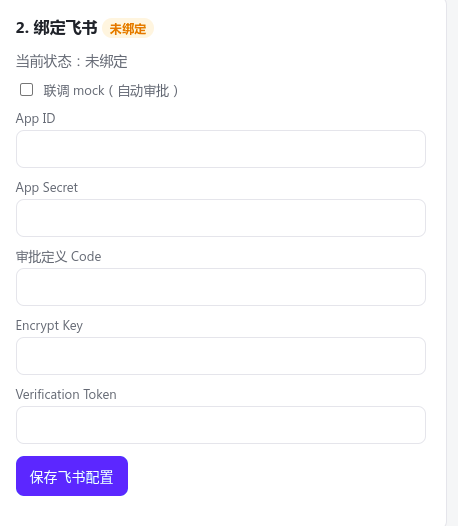

| 字段 | 说明 |
|---|---|
| App ID | `cli_…` |
| App Secret | 开放平台凭证 |
| 审批定义 Code | 上一节发布得到的 code |
| Encrypt Key | 事件加密策略 |
| Verification Token | 事件校验 token |

绑定成功后状态应为 **已绑定（live）**：

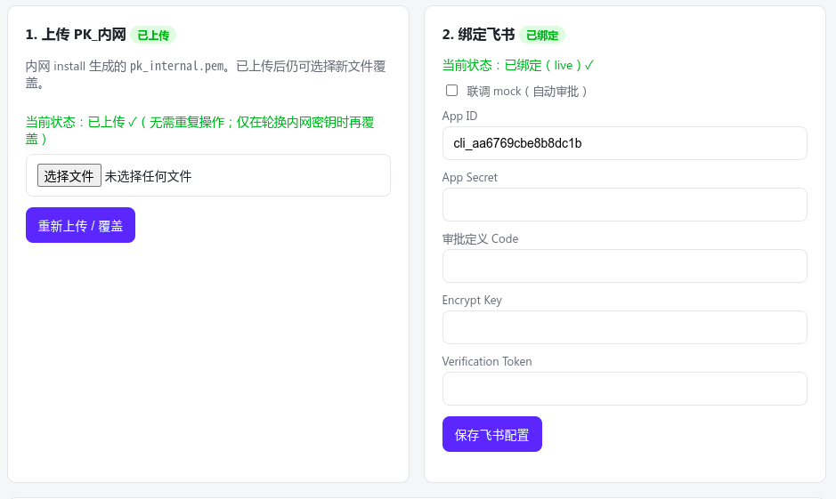

> **安全**：截图或文档中不要出现真实 App Secret / Encrypt Key。若曾泄露，立即在开放平台重置并更新网关配置。

环境变量方式（单租户安装）亦可，见 [部署说明.md](部署说明.md) §4.6：`FEISHU_APP_ID`、`FEISHU_APP_SECRET`、`FEISHU_APPROVAL_CODE`、`FEISHU_ENCRYPT_KEY`、`FEISHU_VERIFY_TOKEN`，且 **`MOCK_FEISHU=0`**。

---

## 11. 内网 Portal：绑定飞书用户 ID

创建审批实例时，飞书要求合法的 **user_id / open_id**（由网关 `UserIDType` 决定，默认常为 `open_id` 或按租户配置为 `user_id`）。

因此 Portal **必须**先把目录账号绑定到飞书用户 ID，否则无法发起导出：

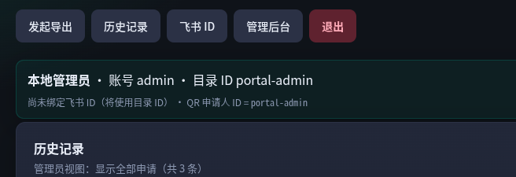

操作：

1. 登录内网 Portal → 点 **飞书 ID**。
2. 填写飞书管理后台中的用户 ID（与网关 `userIdType` 一致）。
3. 保存后再点「发起导出」生成 QR#1。

未绑定或填错时，手机 H5 上常见报错：

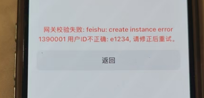

> `1390001 用户ID不正确: e1234` 表示 QR#1 里的申请人 ID 不是飞书可识别的用户。到 Portal「飞书 ID」页改成真实 ID 后重新建单。

---

## 12. 联调验收

按顺序打通：

1. **网关健康**  
   `https://<域名>/healthz` 返回正常；浏览器可打开 `https://<域名>/app/`。
2. **飞书内打开网页应用**  
   工作台进入应用 → 主页为 `/app/`。
3. **Portal 已绑定飞书 ID** → 生成 QR#1（弹窗展示二维码）。
4. 手机在飞书 H5 内 **扫码发起审批**（或联调时粘贴令牌）。  
   令牌形态以 `FDT1.` 开头，例如手机上看到的完整帧：

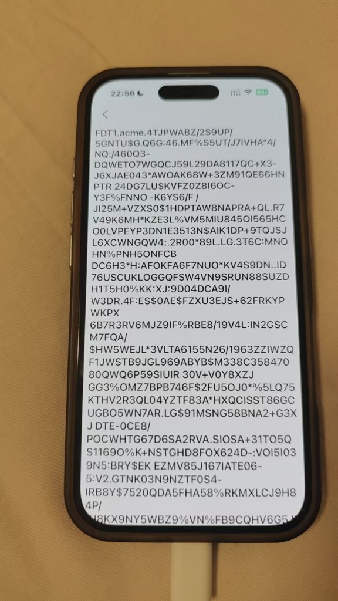

5. 审批人在飞书批 → H5 显示 QR#2。
6. ATM：**先插 U 盘** → 扫 QR#2 兑付（或导入 complete）。

---

## 13. 常见问题

### 13.1 网页打不开 / 连接被关闭

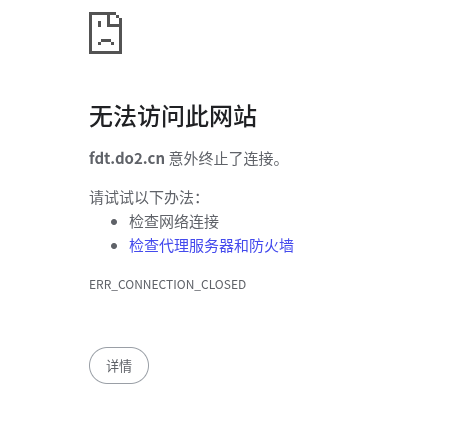

检查：域名 DNS、安全组 80/443、网关进程、证书是否申请成功（ACME）。飞书要求完整可信证书链。

### 13.2 回调保存失败「返回不是合法 JSON」

见 [§7.3](#73-握手顺序必读)：先起网关、密钥一致、再保存事件订阅。

### 13.3 H5 可信域名报错

必须带 `https://` 主机名，不要只填裸域名。见 [§6](#6-安全设置h5-可信域名)。

### 13.4 建审批实例失败 / 表单空白

- 审批控件 id 与 `feishu-form.json` / Portal 导出不一致。
- `approval_code` 填错或审批未发布。
- 仍开着 mock：生产务必 `MOCK_FEISHU=0` / 取消「联调 mock」。

### 13.5 用户 ID 不正确

Portal 绑定真实飞书用户 ID；确认与网关 `userIdType`（`open_id` / `user_id`）一致。见 [§11](#11-内网-portal绑定飞书用户-id)。

### 13.6 ATM：QR#2 验签或有效期失败

常见原因：网关与 ATM 的 `PK_网关` 不一致、时钟偏差、令牌过期、扫到的不是当前审批对应的 QR#2。重新从 H5 拉取最新 QR#2，并核对 ATM 已安装租户后台下载的公钥。

---

## 附录 A · 网关与 H5 端点对照

| 动作 | 方法 | 路径 |
|---|---|---|
| H5 静态页 | GET | `/app/` |
| JSAPI 鉴权 | GET | `/jsapi/config?url=` |
| 提交 QR#1 | POST | `/submit` body `{ "frame": "FDT1...." }` |
| 轮询 / 取码 | GET | `/qr2?reqId=` |
| QR#2 图片 | GET | `/qr2/png?reqId=` |
| 事件回调 | POST | `/callback` 或 `/callback/<tenantId>` |
| 健康检查 | GET | `/healthz` |

---

## 附录 B · 检查清单

- [ ] 自建应用已创建，App ID / Secret 已保存到安全位置  
- [ ] 已添加**网页应用**，桌面/移动主页均为 `https://<域名>/app/`  
- [ ] H5 可信域名为 `https://<域名>`  
- [ ] 审批定义已发布，表单 field 与网关 JSON 对齐，`approval_code` 已填  
- [ ] 事件回调：网关先启动再保存；Encrypt Key / Token 一致  
- [ ] 应用版本已审核通过，可用范围正确  
- [ ] 租户后台：PK_内网已上传，飞书为 **live**（非 mock）  
- [ ] Portal 用户已绑定飞书用户 ID  
- [ ] 真机：扫 QR#1 → 审批 → 出 QR#2 → ATM 兑付成功  

---

*文档版本：与仓库 `docs/部署说明.md` §4–§5 配套。截图目录：`docs/images/feishu/`。*
